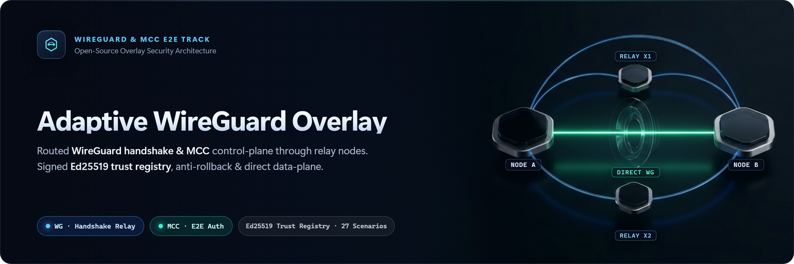

# Adaptive WireGuard Overlay



[](README.md) [](README.ru.md) [](docs/TRUST-REGISTRY-VALIDATION-2026-09-03.md)

Open-source research implementation of routed WireGuard handshake establishment (`WG type 1/2/3` via intermediate relays `A -> X1 -> X2 -> B`) followed by direct encrypted data-plane traffic (`WG type 4: A === B`), plus **Ed25519 signed trust registry** (`v0.2.0`) and **MCC E2E authentication/privacy** tracks.

## Architecture & Components

- `src/wg_handshake_overlay/` — framing parser, protocol adapter, route cache, fail-closed engine, signed Ed25519 trust registry, and 27-scenario model.
- `tests/` — unit & negative-matrix tests (forward/reverse routing, privacy, TTL, duplicates, signatures, anti-rollback, atomic recovery).
- `research/ike-privacy-20261014/` — MCC privacy layer (`mcc_privacy.py`) and local test suite.
- `research/mcc-e2e-20261015/` — MCC E2E authenticated control-plane (`mcc_auth.py`, `mcc_e2e.py`, `trust_registry.py`, integration harness, overhead benchmarks).
- `docs/` & `schemas/` — architecture specs, threat model, rollback boundaries, EVE-NG test contracts, and JSON schemas.
- `config/wg-overlay.example.json` — RFC documentation addresses and placeholder public keys only.

## Local Validation

```bash
bash scripts/validate-local.sh
# or on Windows PowerShell:
pwsh -File scripts/validate-local.ps1
```

Uses Python stdlib and local OpenSSH `ssh-keygen` for temporary Ed25519 SSHSIG signatures; opens no live network sockets and modifies no host configuration.
