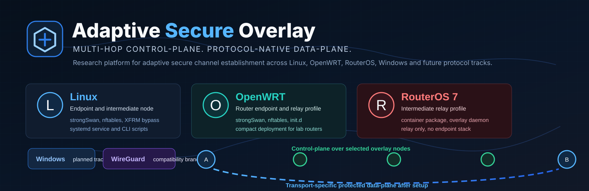

# Adaptive Secure Overlay WireGuard

WireGuard compatibility track for Adaptive Secure Overlay concept exploration.

## Repository family

| Repository | Focus |
| --- | --- |
| [adaptive-ipsec-overlay](https://github.com/Adaptive-Secure-Overlay/adaptive-ipsec-overlay) | Active IPsec track and source of truth |
| [adaptive-ipsec-overlay-linux](https://github.com/Adaptive-Secure-Overlay/adaptive-ipsec-overlay-linux) | Linux endpoint + intermediate package |
| [adaptive-ipsec-overlay-openwrt](https://github.com/Adaptive-Secure-Overlay/adaptive-ipsec-overlay-openwrt) | OpenWRT endpoint + intermediate package |
| [adaptive-ipsec-overlay-routeros7](https://github.com/Adaptive-Secure-Overlay/adaptive-ipsec-overlay-routeros7) | RouterOS 7 intermediate relay |
| [adaptive-secure-overlay-windows](https://github.com/Adaptive-Secure-Overlay/adaptive-secure-overlay-windows) | Windows service/client path |

## Planned scope

- Overlay-assisted session setup experiments for WireGuard-oriented flows
- Control-plane compatibility and configuration forwarding patterns
- Protocol-agnostic abstractions for route planning and relay selection
- Shared policy and security model with the IPsec track

## Status

Research branch placeholder. Current work focus remains on IPsec implementation in Linux/OpenWRT/RouterOS, while this branch captures the future portability direction.
