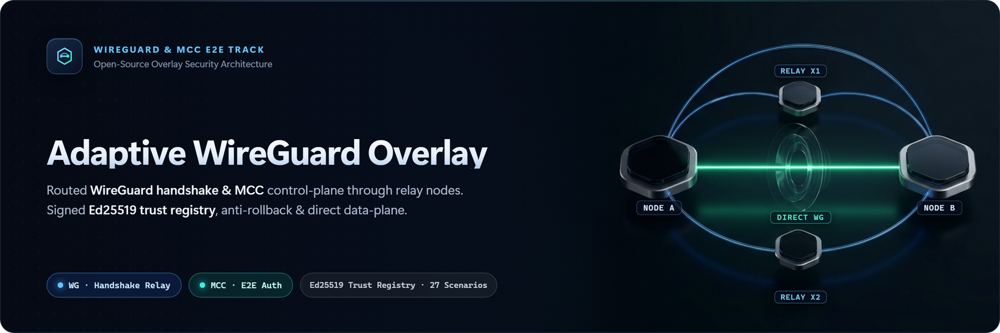

# Adaptive WireGuard Overlay



[](README.md) [](README.ru.md) [](docs/TRUST-REGISTRY-VALIDATION-2026-09-03.md)


Локальный исследовательский пакет аналога legacy-схемы:

```text
WG type 1/2/3: A -> X1 -> X2 -> B и обратно
WG type 4:     A ================= B напрямую
```

WG-конфиги и ключи заранее находятся только на endpoint. Overlay переносит
opaque handshake/cookie datagrams, но не private keys, PSK, `AllowedIPs` или
пользовательский трафик.

Версия `0.2.0` дополнительно требует аутентифицированный каталог
`node_id → WireGuard public key`: его каноническое содержимое подписывается
Ed25519, а доверенный OpenSSH public root закрепляется вне самого каталога.

## Что готово

- `src/wg_handshake_overlay/` — framing parser, protocol adapter, route cache,
  fail-closed engine, подписанный trust registry и модель 27 сценариев;
- `tests/` — parser, adapter, forward/reverse, privacy, TTL, duplicate,
  canonical scenario matrix, подпись, anti-rollback и atomic recovery;
- `docs/ARCHITECTURE.md` — граница общей и WG-специфичной логики;
- `docs/adapter-api.md` — контракт интеграции с существующим overlay daemon;
- `docs/EVE-NG-TEST-CONTRACT.md` — критерии отдельного стендового прогона;
- `docs/EVE-NG-TRUST-REGISTRY-TEST-CONTRACT.md` — отдельный контракт проверки
  подписанного реестра владельцем тестового стенда;
- `docs/TRUST-REGISTRY-MAKE-OR-BUY.md` — выбор готового криптографического
  примитива и граница собственной логики;
- `docs/TRUST-REGISTRY-VALIDATION-2026-09-03.md` — результат security fix и
  негативной матрицы;
- `docs/TRUST-REGISTRY-CHECKPOINT-20260903.json` — машинный локальный
  checkpoint версии 0.2.0;
- `docs/TRUST-REGISTRY-CHECKPOINT-20260903.sha256` — контрольные суммы
  готового пакета;
- `docs/THREAT-MODEL-ROLLBACK.md` — безопасность и rollback boundary;
- `docs/DEVELOPMENT-CLOSURE-2026-08-30.md` — финальная граница готовности;
- `docs/DEVELOPMENT-CHECKPOINT-20260830.json` — машинная запись checkpoint;
- `docs/DEVELOPMENT-CHECKPOINT-20260830.sha256` — контрольные суммы пакета;
- `config/wg-overlay.example.json` — только RFC documentation addresses и
  placeholder public keys;
- `schemas/eve-result.schema.json` — машинный формат результата EVE-NG;
- `schemas/trust-registry.schema.json` — строгий формат подписанного каталога;
- `scripts/privileged/` — только неисполняемый проектный шаблон.

## Безопасная локальная проверка

```powershell
pwsh -File scripts/validate-local.ps1
```

```bash
bash scripts/validate-local.sh
```

Проверка использует Python stdlib и установленный OpenSSH `ssh-keygen` только
для локальных Ed25519 SSHSIG signatures. Она не открывает сокеты, не вызывает
`wg`, `nft`, `ip`, `tcpdump`, SSH-соединение или EVE-NG и не меняет сетевую
конфигурацию хоста. Тестовые signing keys существуют только во временных
каталогах и удаляются после теста.

Реальный capture/inject/firewall backend и EVE-NG запуск требуют отдельного
одобрения владельца изолированного тестового контура.

## Исследовательские модули (октябрь 2026)

- `research/ike-privacy-20261014/` — прототип приватности IKE/MCC (`mcc_privacy.py`) и локальные тесты.
- `research/mcc-e2e-20261015/` — сквозная аутентификация и шифрование MCC E2E (`mcc_auth.py`, `mcc_e2e.py`, `trust_registry.py`, интеграционные тесты и бенчмарк накладных расходов).
